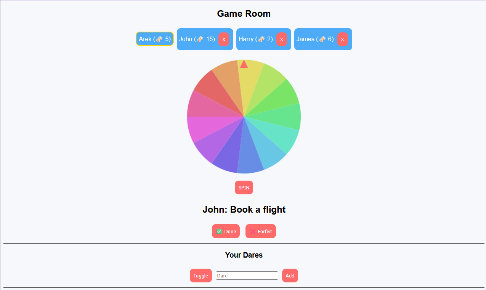

# PartyGame
## The game contains the following
- A host and player separation of roles for lobby moderation
- Anonymous dare system where all players can add a dare throughout the game
- A randomised algorithm of matching a player and a dare
- A visual spinning wheel to add some fun and anticipation
- If a player decides a dare is too difficult, they can choose to forfeit the dare at a cost (randomly given 1 to 4 shots)
- A shots taken counter is displayed beside the player names
- A toggle system for hiding your dares in case another person decides to peek



### How to run this party game!

1. Install Python
- Make sure Python 3.10+ is installed.
- On Windows download from python.org.
- On Mac usually preinstalled, or use Homebrew: brew install python
- On Linux: sudo apt install python3 python3-pip.


2. Install Required Packages
Open a terminal and run
```bash
pip install flask flask-socketio eventlet
```


3. Save Your Python Script
- Save your code in a file name, for example, `PartyGame.py`.


4. Run The Game
- Open a terminal in the folder where `PartyGame.py` is saved
- Run: 
```bash
python PartyGame.py
```
- If it works, the terminal will show something like:
```bash
Running on http://0.0.0:5000/ (Press CTRL+C to quit)
```


5. Open the Game in a Browser
- Open any web browser
- Go to:
`http://localhost:5000`
- That's the home page. From here you can **host or join a game**


6. Playing on the Same Network
- If your friend wants to join from another computer on the same Wi-Fi, theu need your computer's local IP.
- Find IP:
-   Windows: `ipconfig` ==> look for IPv4 address
-   Mac/Linux `ipconfig` ==> look for inet under your Wi-Fi
- Open browser on another device:
`http://YOUR_IP:5000`
